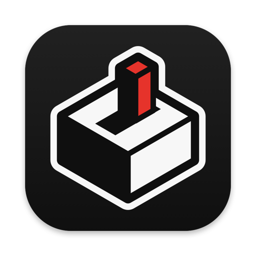
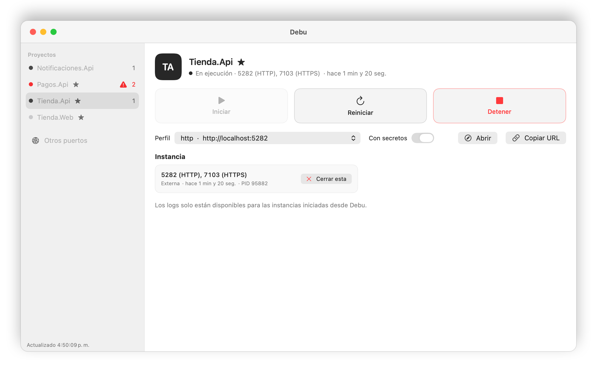
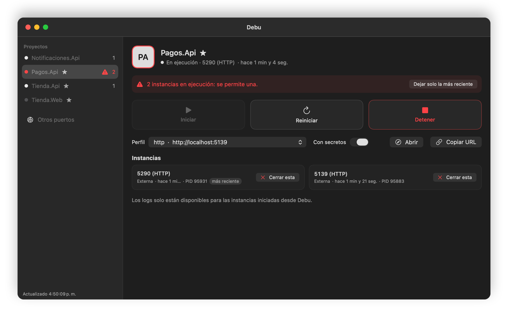
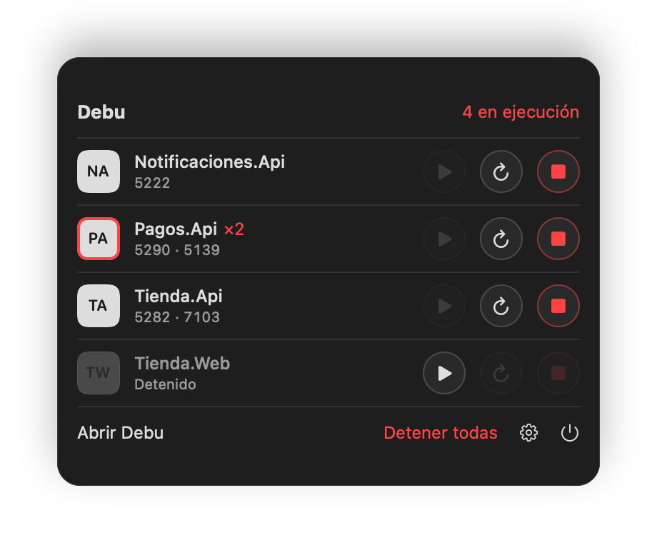

<p align="center">
  
</p>

<h1 align="center">Debu</h1>

<p align="center">
  <strong>Todas tus instancias .NET en un solo lugar.</strong><br>
  Mirá qué está corriendo, en qué puerto, y detené, reiniciá o iniciá proyectos sin tocar la terminal.
</p>

<p align="center">
  
  
  
  
</p>

<p align="center">
  
</p>

---

## Por qué existe

En Windows, Visual Studio corre una instancia por ventana y listo. En macOS, con VS Code, el depurador, la terminal y agentes como Claude Code, el mismo proyecto termina corriendo dos o tres veces en puertos distintos, y ninguna herramienta te muestra todo junto.

Debu vive en la barra de menú, detecta **todos** los procesos .NET que escuchan en un puerto, sin importar quién los inició, y te deja controlarlos con un clic.

## Qué hace

| | |
|---|---|
| **Detecta todo** | Lista cada proceso .NET en escucha, iniciado desde la terminal, VS Code, Claude Code o la propia app, con su proyecto, puertos, protocolo (HTTP o HTTPS) y tiempo en ejecución. |
| **Marca duplicados** | Agrupa las instancias por proyecto y marca en rojo cuando hay más de una. Con un clic dejás solo la más reciente. |
| **Iniciar, reiniciar, detener** | Tres botones grandes por proyecto. Detener baja todo el árbol de procesos, incluido `dotnet watch`. Reiniciar vuelve a levantar el proyecto en el mismo puerto. |
| **Perfiles y secretos** | Elegí el perfil de `launchSettings.json` (HTTP, HTTPS u otro) e iniciá con o sin user-secrets. |
| **Una instancia por proyecto** | Si el proyecto ya corre, Debu avisa y ofrece reemplazarlo en lugar de abrir otra. |
| **Logs** | Ves la salida de consola de lo que iniciaste desde Debu, con aviso si falta el certificado HTTPS de desarrollo. |
| **Barra de menú** | Contador de instancias (en rojo si hay duplicados) y tus proyectos favoritos con sus tres botones, siempre a mano. |
| **Lista siempre al día** | Vigila tus carpetas: si cambiás de rama o aparece un proyecto nuevo, la lista se actualiza sola. |

<p align="center">
  
</p>

<p align="center">
  
</p>

## Instalación

### Requisitos

- macOS 26 o posterior (probado en Apple Silicon).
- [Xcode](https://apps.apple.com/app/xcode/id497799835) 27 o posterior, instalado desde la App Store.
- El [SDK de .NET](https://dotnet.microsoft.com/download) que usan tus proyectos.

### Pasos

1. Cloná el repositorio:

   ```bash
   git clone https://github.com/tomasmalvissi/debu.git
   cd debu
   ```

2. Compilá e instalá en Aplicaciones:

   ```bash
   ./scripts/install.sh
   ```

   El script compila en modo Release, cierra Debu si estaba abierto y copia `Debu.app` a `/Applications`. Usa el Xcode instalado aunque la terminal apunte a las Command Line Tools.

3. Abrilo desde **Aplicaciones** o con:

   ```bash
   open /Applications/Debu.app
   ```

Para actualizar después de un `git pull`, volvé a correr `./scripts/install.sh`.

> La app se compila en tu Mac y se firma para uso local, así que abre sin advertencias de seguridad. No está pensada para distribuirse a otras personas.

### Primer uso

1. Abrí **Debu > Settings…** (⌘,) y agregá la carpeta donde tenés tus proyectos, por ejemplo `~/Projects`.
2. Debu busca los proyectos web .NET de forma recursiva y los muestra a la izquierda.
3. Marcá con la estrella los que usás seguido: aparecen siempre en la barra de menú, aunque estén detenidos.
4. Opcional: en **Settings** activá **Abrir Debu al iniciar sesión**.

## Cómo funciona

- **Detección:** cada 3 segundos con la ventana o el menú abiertos (10 en segundo plano), Debu lee los puertos en escucha con `lsof` y los datos de cada proceso con `ps`. Asocia cada proceso con su proyecto por el directorio de trabajo y las rutas de su línea de comandos.
- **Detener:** sube por el árbol de procesos hasta `dotnet run` o `dotnet watch` y detiene primero los lanzadores, porque si solo muere la app, `dotnet watch` la vuelve a levantar. A la app le envía `SIGTERM` para que ASP.NET Core cierre en orden, y `SIGKILL` si no termina.
- **Iniciar:** ejecuta `dotnet run --project … --launch-profile …`. El modo sin secretos apunta `APPDATA` a una carpeta vacía: .NET busca los user-secrets ahí y no los encuentra, y el entorno sigue en `Development`.
- **Reiniciar:** toma el perfil y los puertos de la instancia más reciente (de su línea de comandos si la inició otro), detiene todas e inicia una sola.

Debu no usa dependencias externas: solo Swift, SwiftUI y las APIs de macOS.

## Limitaciones conocidas

- Necesita correr sin App Sandbox para ver y detener otros procesos.
- No ve procesos dentro de máquinas virtuales (por ejemplo, proyectos .NET Framework en Windows) ni procesos de otros usuarios o iniciados con `sudo`.
- Al reiniciar una instancia que iniciaste desde la terminal o el depurador, la nueva queda a cargo de Debu: se pierde esa terminal o sesión de depuración.
- Si una instancia se inició con `dotnet watch`, al reiniciarla vuelve con `dotnet run`, sin recarga automática.
- Inicia sin depurador. Para depurar, adjuntate desde VS Code con *Attach to Process*.

## Desarrollo

Abrí `Debu.xcodeproj` en Xcode y ejecutá con **Product > Run** (⌘R).

```
Debu/
├── DebuApp.swift, AppDelegate.swift   Punto de entrada, ventana, barra de menú y salida
├── AppState.swift                      Estado observable: procesos, proyectos, acciones
├── Models/                             RunningProcess, DotnetProject, AppLaunch
├── Services/                           lsof/ps, detención por árbol, inicio, descubrimiento, FSEvents
└── Views/                              Ventana, panel de proyecto, barra de menú, logs, ajustes
design/
├── generate-icons.swift                Genera el ícono de la app y el de la barra de menú
└── alternativa-D/                      Ícono alternativo "D", guardado y sin usar
scripts/install.sh                      Compila en Release y copia a /Applications
```

Para regenerar los íconos, por ejemplo después de cambiar el tono de rojo:

```bash
DEVELOPER_DIR=/Applications/Xcode.app/Contents/Developer xcrun swift design/generate-icons.swift
```
